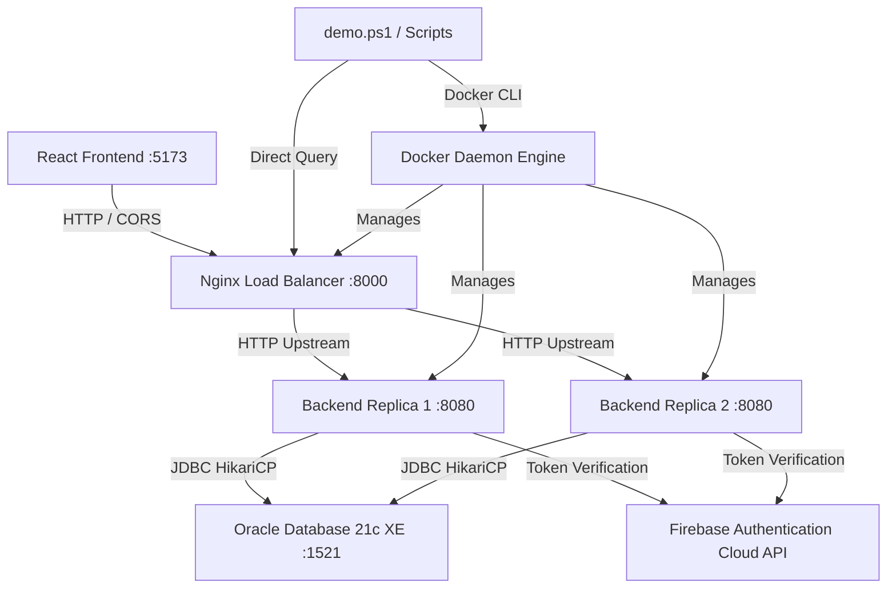
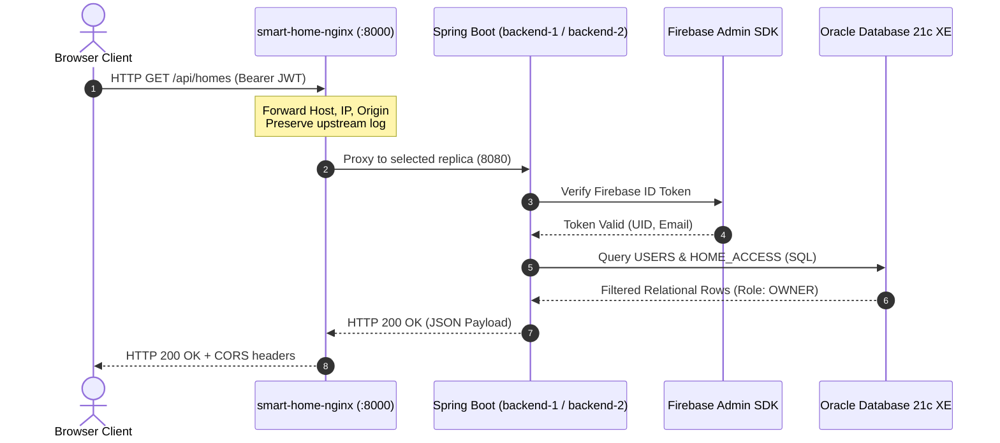

# System Architecture — Canonical Specification & Abstraction Tower

**System:** Smart Home / IoT Device Monitoring & Spatial Digital Twin  
**Owner:** Systems Architecture  
**Status:** Canonical & Active  

---

## 1. System Purpose & Identity

The Smart Home System is an enterprise-grade IoT device monitoring, automation, and spatial telemetry platform. It models real-world residential estates, multi-floor rooms, parent-hub/child-sensor device hierarchies, time-series telemetry streams, automated threshold rule actions, and role-based owner/member tenancy permissions.

---

## 2. The Tower of Abstractions (Layer 0 to Layer 10)

The system is organized into an 11-tier abstraction hierarchy. Information flows down via commands and configurations, and flows up via events, telemetry, and observability.

```text
Layer 10: Long-Term Knowledge & Accretion (ADRs, Runbooks, Signatures, Provenance)
    ^
Layer 9:  Agent Operating Model (OBSERVE -> ORIENT -> PLAN -> ACT -> VERIFY)
    ^
Layer 8:  Decision & Control Plane (Nginx Upstream Rebalancing, CLI Operations)
    ^
Layer 7:  Observability & Evidence (Nginx Access Logs, HikariCP Metrics, Stats)
    ^
Layer 6:  Workflows & Business Automation (PL/SQL Triggers, Alert Processing)
    ^
Layer 5:  Data & State (Oracle 21c XE Relational Schema, Sequences, Tables)
    ^
Layer 4:  Domain Capabilities (Homes, Rooms, Devices, Alerts, SQL Console, 3D Twin)
    ^
Layer 3:  Services & Application Runtime (Spring Boot REST APIs, Security Filters)
    ^
Layer 2:  Runtime & Processes (Docker Containers: backend1, backend2, nginx)
    ^
Layer 1:  Infrastructure & Network (Docker Bridge net, host.docker.internal, Ports)
    ^
Layer 0:  Physical & External World (Developer Host PC, OS Network Stack, Firebase)
```

### Abstraction Layer Contract Table

| Layer | Name | Responsibility | Interfaces / Boundaries | Key Invariants |
| :-: | :--- | :--- | :--- | :--- |
| **L10** | Knowledge & Accretion | Durable memory across agent turns | Markdown in `docs/KNOWLEDGE/`, `docs/DECISIONS/` | Never record transient runtime state as canonical |
| **L9** | Agent Operating Model | Disciplined decision lifecycle | `AGENTS.md`, 9-stage loop | Always precheck invariants before mutating files |
| **L8** | Control Plane | Operational configuration & rebalancing | `docker exec`, `nginx -s reload`, scripts | Operations must be idempotent and reversible |
| **L7** | Observability | Empirical proof & telemetry | Nginx access logs, `docker stats`, `/actuator` | Observations must be verifiable with raw output |
| **L6** | Workflows | Automation rules & stored procedures | `TRG_PREVENT_DEVICE_CYCLE`, `SP_ACKNOWLEDGE_ALERT` | Enforced inside database transaction boundary |
| **L5** | Data & State | 17 normalized relational tables | JDBC thin driver, HikariCP pool | Schema is source of truth (`ddl-auto=none`) |
| **L4** | Domain Capabilities | Business models (Homes, Devices, Alerts) | REST JSON payloads, Three.js coordinates | Scoped strictly to authenticated user identity |
| **L3** | Services | HTTP endpoints, token verification | Spring Security, `FirebaseAuthenticationFilter` | Stateless JWT Bearer tokens on every request |
| **L2** | Runtime / Containers | Process encapsulation & replicas | Docker Compose (`backend1`, `backend2`, `nginx`) | Identical container images (`smart-home-backend`) |
| **L1** | Infrastructure | Virtual networking & port bindings | Port `8000` public, `8080` private, `1521` DB | `host.docker.internal` bridges container to host |
| **L0** | Physical / External | Host OS, JVM, Node runtime, Firebase | Windows 11 host, Firebase Auth Cloud API | Host Oracle XE port `1521` must never be closed |

---

## 3. High-Level Runtime Topologies

### Topology A — Docker + Nginx Load-Balanced Production Topology (Current Assignment Mode)
```text
[ Browser / Client ]
         |
         | HTTP Requests (Port 8000)
         v
[ smart-home-nginx ] (Nginx 1.31 / Alpine)
         |
         +--- Round-Robin / Weighted ---> [ smart-home-backend-1:8080 ] (Spring Boot 4.1.1)
         |                                           |
         +--- Round-Robin / Weighted ---> [ smart-home-backend-2:8080 ] (Spring Boot 4.1.1)
                                                     |
                                                     | JDBC (host.docker.internal:1521)
                                                     v
                                  [ Host Oracle Database 21c XE (XEPDB1) ]
```

### Topology B — Local Host Development Topology (Zero Docker Overhead)
```text
[ React 19 Frontend (Vite) ]  (:5173)
         |
         | HTTP / JSON (Bearer Token)
         v
[ Spring Boot REST API ]      (:8080)
         |
         | JDBC (localhost:1521/XEPDB1)
         v
[ Host Oracle Database 21c XE ]
```

### Topology C — Temporary Public Demonstration Topology (Cloudflare Tunnel)
```text
[ Public Vercel Frontend ]
         |
         | HTTPS
         v
[ Cloudflare Quick Tunnel (*.trycloudflare.com) ]
         |
         v HTTP
[ Host Spring Boot (:8080) ] ---> [ Host Oracle Database 21c XE ]
```

---

## 4. Dependency Graph



---

## 5. Data Flow & Security Boundaries



---

## 6. Subsystem Boundaries

| Subsystem | Directory | Responsibilities | Boundary Invariants |
| :--- | :--- | :--- | :--- |
| **Backend API** | `backend/` | REST Controllers, Services, Entities, Spring Security | Never alters DB schema; stateless JWT auth only |
| **Frontend UI** | `frontend/` | React SPA, Vite builder, Tailwind styling, Three.js | Talks only to centralized `VITE_API_URL` |
| **Database** | `database/` | 17 Master Tables, Sequences, Triggers, PL/SQL | Source of truth; strict relational integrity |
| **Reverse Proxy** | `nginx/` | Ingress gateway, round-robin/weighted balancing, logs | Never adds duplicate CORS headers |
| **Automation** | `scripts/` | Automated test suites, presentation dashboard (`demo.ps1`)| Pure PowerShell, idempotent execution |
| **Documentation**| `docs/` | Architectural specifications, runbooks, ADRs | Accurate to live repository; machine-legible |
